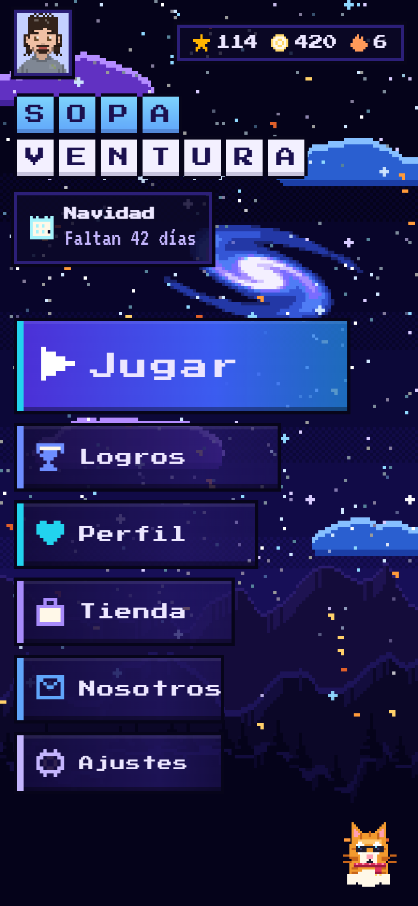
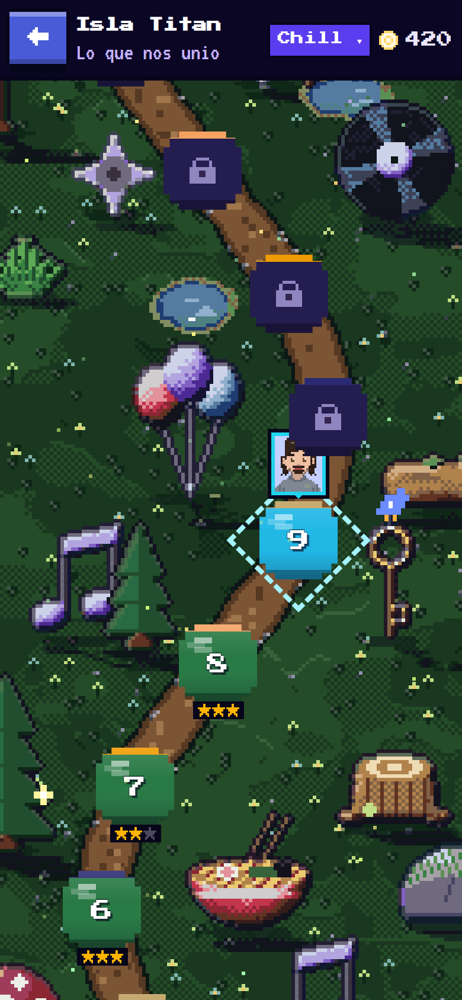
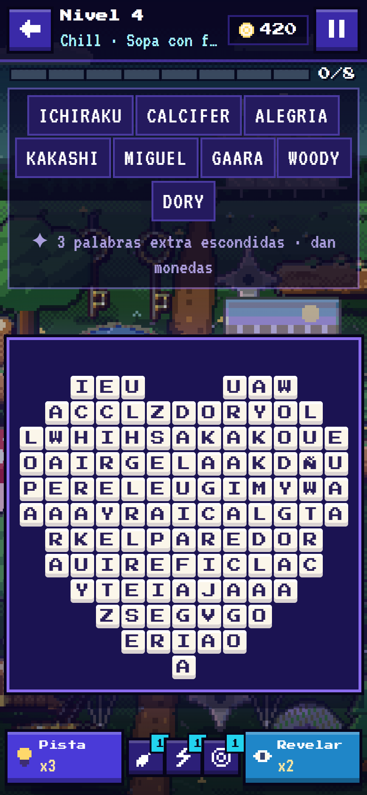
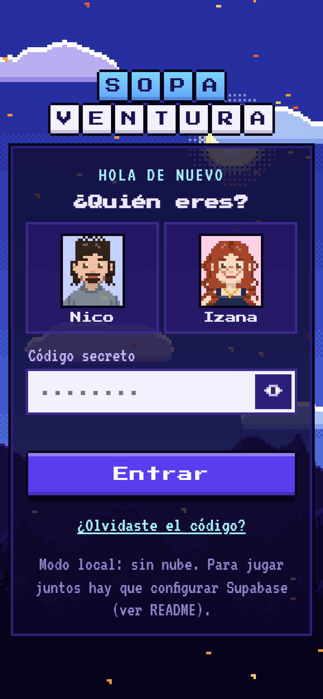
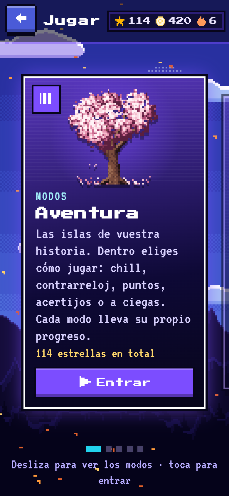
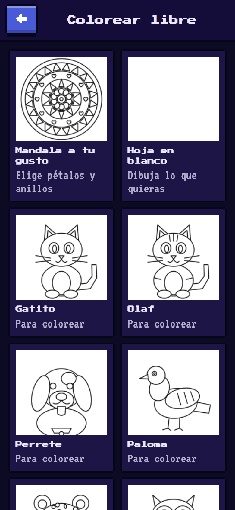
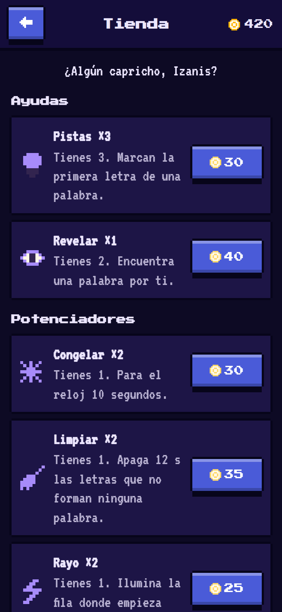
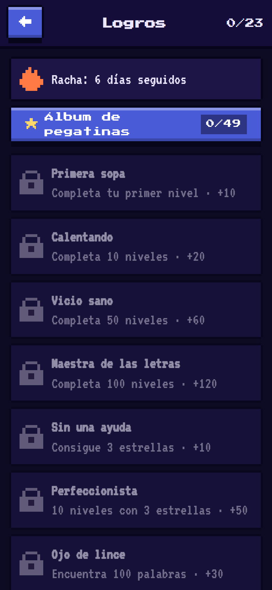
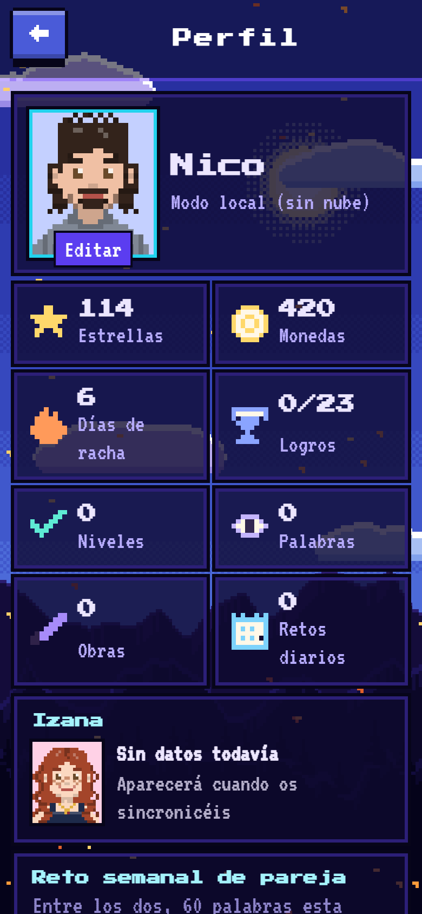

# SopaVentura

Sopa de letras en español con estética **pixel art**, hecha como regalo privado para dos personas. Es una **PWA**: se instala desde el navegador del móvil, funciona **sin internet** y no necesita tiendas de apps ni cuentas de desarrollador.

<p align="center">
  
  
  
</p>

## Qué incluye

**Juego**
- Mapa de **islas** estilo Candy Crush con escenarios pintados en pixel art, criaturas tocables, clima por hora del día y estación, y progreso propio por modo.
- **Modos:** Chill, Contrarreloj, Con puntos, Acertijos y A ciegas, además de reto diario, islas sin fin (modo Infinito) y reto semanal de pareja.
- **Tipos de nivel** que suben de dificultad: lluvia de palabras cortas, palabras largas, sopas con forma (corazón, círculo, gato…), niebla, trampa, gigante y jefes.
- **Palabras extra** escondidas, palabras secretas, combos, potenciadores (Congelar, Limpiar, Rayo, Radar), pistas y tienda con monedas.
- Logros, pegatinas, misiones semanales, estadísticas por modo y fechas especiales con regalo.

**Pintar**
- **Pintar por números** con dibujos pixel art de hasta 64×64 y 32 colores, modo "por zonas", time-lapse y GIF del resultado, tarjeta de victoria para compartir y conversor de foto a pixel art.
- **Colorear libre** con dibujos de línea, mandala, cubo, pincel, goma y cuentagotas.

**Dos jugadores**
- Entrada con un código secreto compartido, monedas compartidas, mensajes, cartas (también programadas) y buzón.
- **Jugar juntos** en directo: duelo, en equipo y pintar juntos (también contra el bot Olaf).
- Sopas hechas a mano que se regalan por el buzón y retos del tipo "supera mi tiempo".

**Accesibilidad y ajustes**
- Modo daltónico, letra grande, tamaño de tablero, volúmenes de música y efectos por separado, navegación con teclado y copia de seguridad exportable.

<p align="center">
  
  
  
  
  
  
</p>

## Tecnología

- **Vite + TypeScript**, sin framework de interfaz. Dibujo con **Canvas 2D** y capas CSS para los efectos.
- **Pixel art generado por código** (escenarios, personajes, objetos y dibujos para pintar): no hay imágenes con copyright. Los escenarios se pintan en un **Web Worker** para no bloquear la interfaz.
- **Audio sintetizado** con Web Audio (efectos y música): sin archivos de sonido ni licencias.
- **Supabase** como backend: sesión anónima y código de pareja comprobado en el servidor (hash bcrypt), reglas de acceso (RLS) por pareja, sincronización con cola offline, **Realtime** para jugar juntos y notificaciones push (VAPID).
- **Service worker** para funcionar sin conexión y **Cloudflare Pages** para publicarlo.
- Pruebas con **Vitest** y pruebas en navegador con **Puppeteer** (flujo completo, botones, rendimiento).

## Organización

```
src/core        Reglas: generador de niveles, dificultad, progreso, logros, estado
src/data        Contenido editable: palabras, islas, temas, pistas
src/paint       Pintar por números, escenarios pixel art, GIF, tarjeta de victoria
src/net         Supabase, modo local, cola offline, sincronización, notificaciones
src/screens     Pantallas
src/ui          Audio, efectos, iconos pixel, rutas, cielo animado
supabase/       Base de datos (SQL), función de notificaciones, ejemplo de cron
docs/           Guías y capturas
e2e/            Pruebas en navegador
```

## Probarlo en local

```bash
npm install
npm run dev
```

Sin configurar nada funciona en **modo local** (todo se guarda en el navegador; entra con "Nico" o "Izana" y cualquier código de 4 o más caracteres). Para usar la nube, copia `.env.example` a `.env` y rellénalo (guía en `docs/SUPABASE.md`).

| Comando | Para qué |
|---|---|
| `npm run dev` | Servidor de desarrollo |
| `npm run build` | Compilar para publicar (carpeta `dist`) |
| `npm run preview` | Servir la versión compilada |
| `npm test` | Pruebas automáticas |
| `npm run e2e` | Prueba completa en un Chrome de móvil emulado |
| `node e2e/capturas.mjs` | Regenera las capturas de `docs/capturas` |

## Publicar e instalar

1. Repositorio **privado** en GitHub y proyecto en **Cloudflare Pages** conectado a él (comando `npm run build`, carpeta `dist`).
2. Variables de entorno en Cloudflare: `VITE_SUPABASE_URL`, `VITE_SUPABASE_ANON_KEY`, `VITE_VAPID_PUBLIC_KEY`.
3. En el iPhone: abrir la dirección en **Safari** > Compartir > **Añadir a pantalla de inicio**, y abrir la app desde el icono.

## Seguridad

- **Nunca** hay claves ni contraseñas en el código ni en el repositorio. Las variables `VITE_*` van en `.env` (ignorado por git) y en el panel de Cloudflare. La clave de servicio y la privada VAPID solo viven en Supabase.
- La clave pública de Supabase está pensada para el navegador: la protegen las reglas RLS de `supabase/migrations/0001_init.sql`.
- Las fotos y el contenido personal están fuera del repositorio (`private/`, y Supabase).

## Límites conocidos

- La vibración en iPhone depende de un truco háptico que puede no notarse; el juego también se apoya en animación y sonido.
- El plan gratuito de Supabase pausa el proyecto tras una semana sin uso; `docs/SUPABASE.md` explica cómo evitarlo.

Guías: `docs/SUPABASE.md` (nube y notificaciones paso a paso) · `docs/A_VERIFICAR.md` · `docs/ANIMACIONES.md`.
